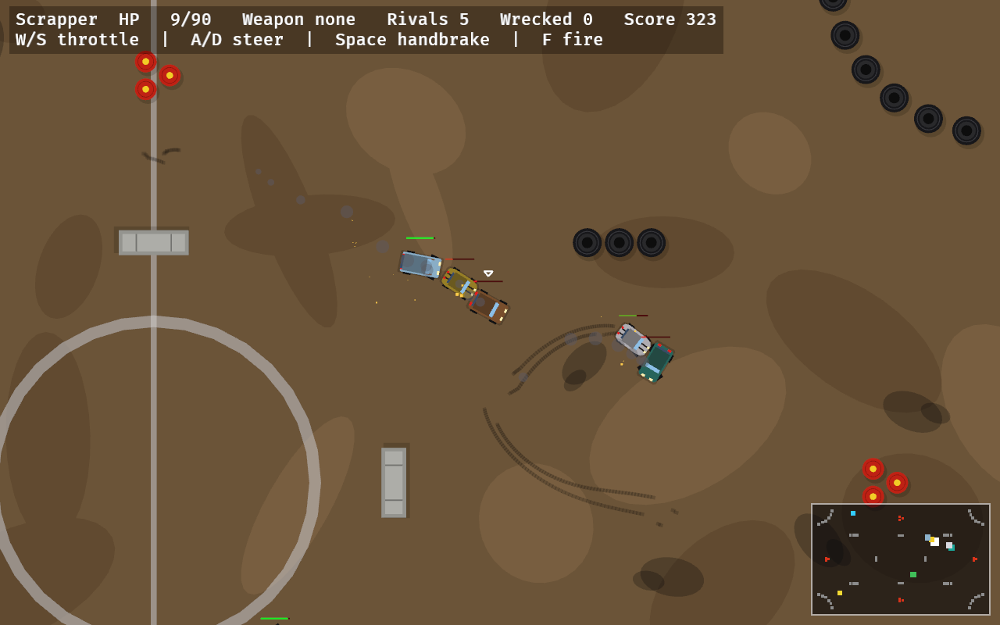
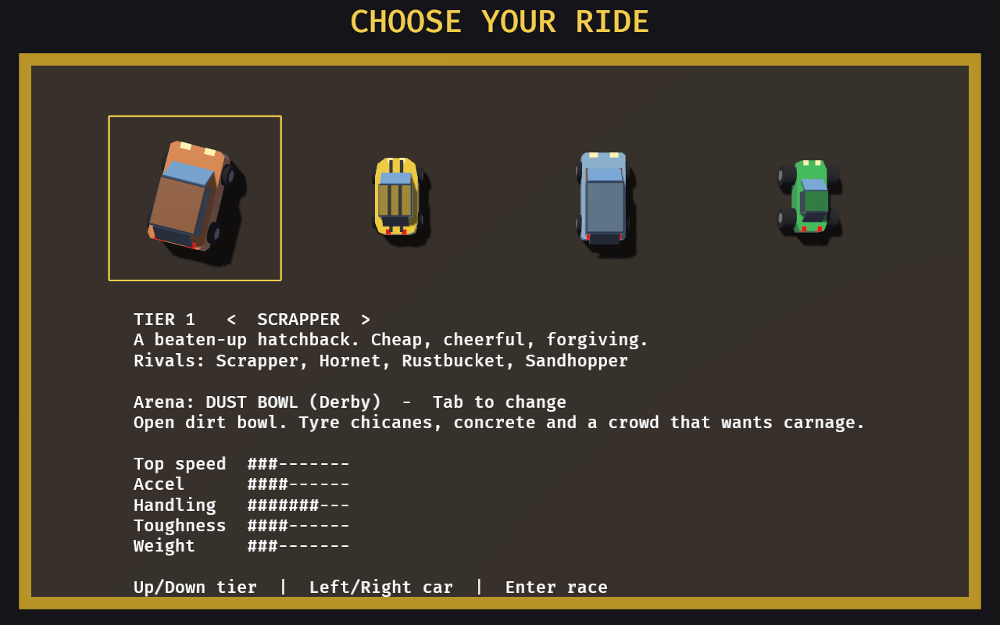
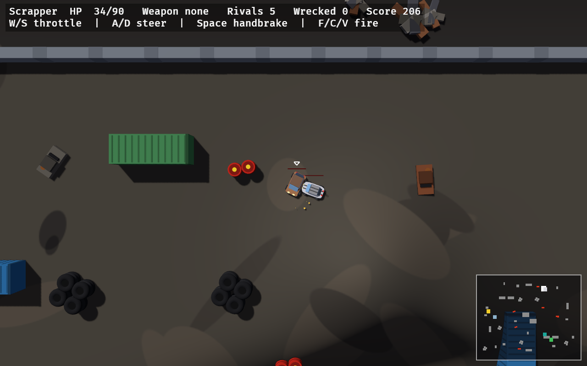
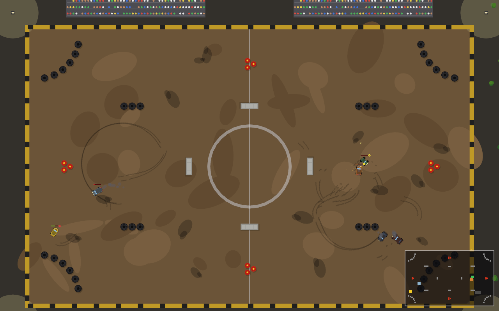
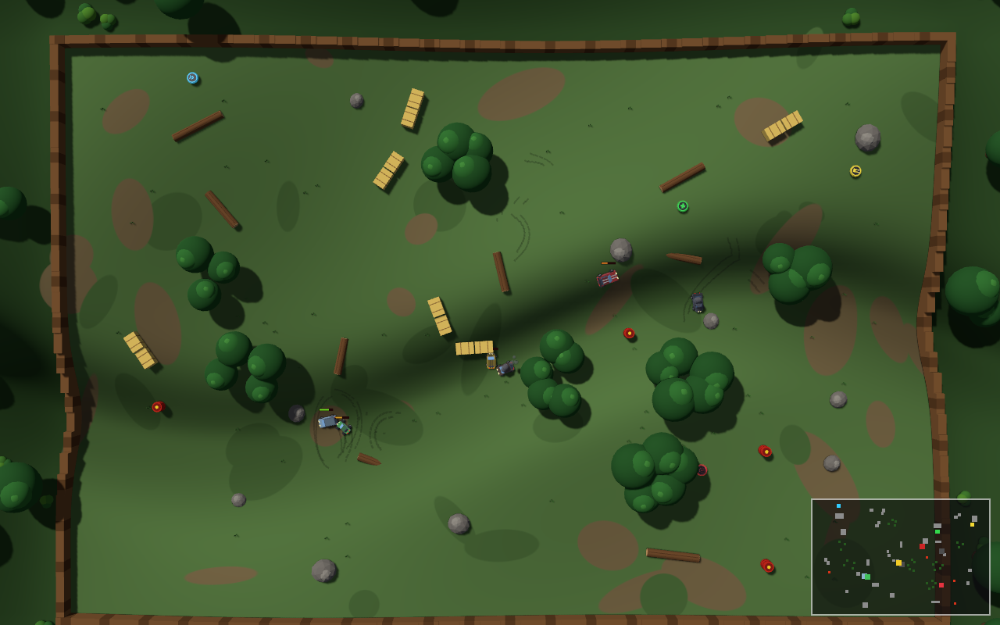
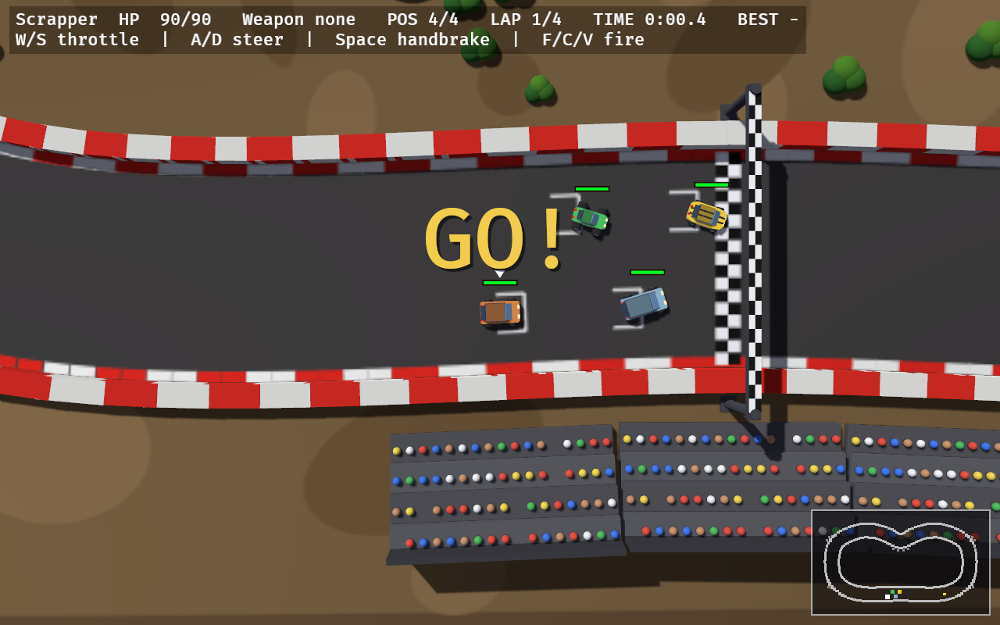
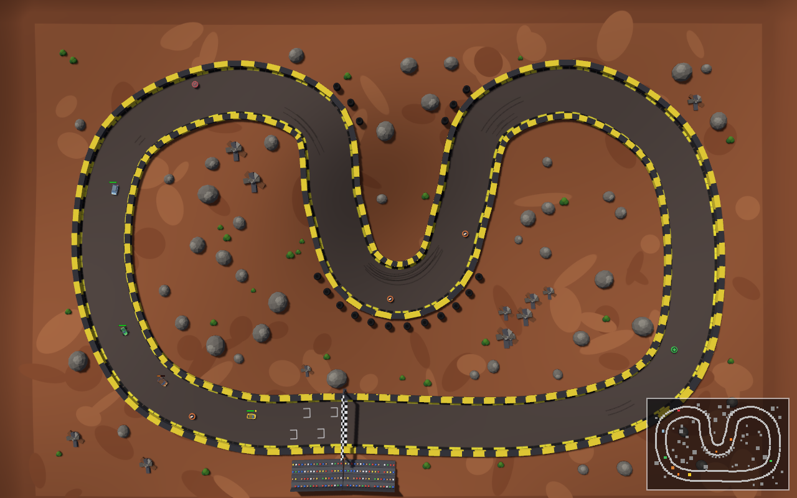

# Arena Drift

[](https://github.com/froks/arena-drift/actions/workflows/ci.yml)
[](https://github.com/froks/arena-drift/actions/workflows/pages.yml)

A top-down 3D demolition derby and racer written in Rust with [Bevy](https://bevy.org). Pick a car, then either
drive into the arena and wreck your rivals until you're the last one still running, or race three rivals round a
track.

**▶ [Play in your browser](https://froks.github.io/arena-drift/)**, download a build for Linux, Windows or macOS
from the latest [CI run](https://github.com/froks/arena-drift/actions/workflows/ci.yml) (under *Artifacts*), or
build it yourself (see below).



## Features

- **Two modes.** The start menu offers *New race* and *Arena* (demolition derby).
- **Race mode.** Four cars line up on a grid behind the start/finish line, wait out a 3-2-1 countdown and race a
  few laps. The HUD shows your position, lap, race time and best lap. The AI drivers race rather than hunt: they
  brake for corners, take the inside line, overtake and detour for power-ups near the racing line. They still shoot
  whoever is in front of them.
- **3 race tracks:**
  - *Dustline Speedway:* fast sweepers round a dusty oval with a kink on the back straight, and a ramp that
    throws you into the air (4 laps).
  - *Red Canyon:* long and technical, with a hairpin that drops into a canyon and a jump over a ravine. Hit the
    boost pad and the ramp flat out, or fall in and lose time (3 laps).
  - *Pine Ridge:* through the woods and over the hills. A river crosses the track twice: once on a bridge and once
    through a shallow ford that slows you down (4 laps).
- **Track features:** boost pads give a kick and a moment of turbo. Cars fly off ramps and land where physics puts
  them. If you fall into a ravine or the river, or land beside the track, you're put back on the track.
- **Drifty car handling.** Cars slide sideways, and the handbrake kicks the tail out. Collisions use rotated
  boxes, so a hit on a corner spins the car round.
- **Damage that depends on the hit.** Ramming nose-first hurts the other car more than you, and taking a hit in
  the side hurts the most. Heavy cars shrug off hits from light ones. Damaged cars darken and smoke, and wrecks
  stay in the arena as obstacles.
- **12 cars in 3 tiers.** Each has its own size, weight, handling and toughness. Your rivals always come from your
  tier.
- **3D arenas with real terrain.** Everything is built from 3D shapes and lit by a low sun that casts shadows.
  The camera looks straight down, but tall things lean out and slide past as you drive (parallax). Slopes pull
  cars downhill, so valleys collect wrecks.
- **3 derby arenas:**
  - *Dust Bowl:* a real bowl, with tyre chicanes, concrete blocks and a crowd in the stands.
  - *Junkyard:* lanes of containers and rusting wrecks, a drainage ditch and junk mounds.
  - *Timberland:* rolling forest floor cut by a creek valley, with trees, logs, rocks and hay bales. Tree tops
    fade out while you drive under them.
- **Obstacles that behave differently.** Tire stacks are bouncy and soft, concrete and rock hurt, and red barrels
  explode (shoot them, ram them, or set off a chain reaction).
- **Power-ups:** health packs, a machine gun, rockets, mines and turbo.
- **Camera and minimap.** The camera follows your car and zooms out with speed, a minimap shows the whole arena,
  and sliding cars leave skid marks.
- **Generated sound.** Every sound effect, including the engine, is synthesised in code, so the game ships with no
  audio files.

| Garage | Junkyard |
|---|---|
|  |  |
| **Dust Bowl** | **Timberland** |
|  |  |
| **Race start (Dustline Speedway)** | **Red Canyon** |
|  |  |

## Controls

| Where | Key | Action |
|---|---|---|
| Menu | Up / Down | Choose race or arena |
| | Enter or Space | Go to the garage |
| Garage | Up / Down | Change tier |
| | Left / Right | Choose a car |
| | Tab | Change arena or track |
| | Enter or Space | Start the match |
| | Esc | Back to the menu |
| Driving | W / Up | Throttle |
| | S / Down | Brake, then reverse |
| | A / D or Left / Right | Steer |
| | Space | Handbrake |
| | Ctrl, F, C or V | Fire the current weapon |
| After a match | Enter | Rematch |
| | G | Back to the garage |
| | M / Esc | Back to the menu |

**Gamepads** work too, natively and in the browser (browsers only report a controller after you press one of its
buttons):

| Where | Control | Action |
|---|---|---|
| Driving | Left stick | Steer (left/right) and throttle / brake (up/down), both analog |
| | Right / left trigger | Throttle / brake and reverse (analog) |
| | A or RB | Fire |
| | B or LB | Handbrake |
| Menus | D-pad or left stick | Choose |
| | A or Start | Confirm |
| | B | Back |
| | Y or Select | Change arena or track |

## Building and running

You need **Rust 1.88 or newer**. The easiest way to get it is [rustup](https://rustup.rs).

```sh
git clone https://github.com/froks/arena-drift.git
cd arena-drift
cargo run
```

The first build compiles Bevy and takes a few minutes. Debug builds already compile dependencies with full
optimisation (see `[profile.dev]` in `Cargo.toml`), so `cargo run` plays smoothly. For a fully optimised build,
use `cargo run --release`.

### System dependencies

Bevy's features are cut down in `Cargo.toml` (no Wayland support), so the list of system packages is short.

**Linux (Debian / Ubuntu):**

```sh
sudo apt install pkg-config libasound2-dev libudev-dev
```

- `libudev-dev` is needed for gamepad support.
- `libasound2-dev` (ALSA) is needed for sound. PipeWire and PulseAudio systems work through their ALSA
  compatibility layer.
- At runtime you need a Vulkan-capable GPU driver (Mesa works) and an X11 session. On Wayland desktops the game runs
  through XWayland.

Other distributions need the equivalent packages, for example `alsa-lib-devel` and `systemd-devel` on Fedora, or
`alsa-lib` and `systemd-libs` on Arch.

**Windows / macOS:** no extra packages should be needed, but these platforms haven't been tested yet.

### Web version

The game also runs in the browser through WebAssembly and WebGL2. It's built with [Trunk](https://trunkrs.dev):

```sh
rustup target add wasm32-unknown-unknown
cargo install --locked trunk

trunk serve                              # dev server at http://127.0.0.1:8080
trunk build --release --public-url ./    # optimised site in dist/
```

The release build uses the size-optimised `web` profile from `Cargo.toml` and runs `wasm-opt`. The page itself
(`index.html`) shows a "Click to play" overlay, because browsers only allow sound and keyboard focus after the player
interacts with the page. Adding `#play` to the URL skips the overlay; sound then starts on the first key press.
Ctrl fires, and the browser's Ctrl+W (close tab) can't be blocked by a page, so while you're playing the page asks
before it's closed.

Every push to `main` builds the site and deploys it to GitHub Pages (`.github/workflows/pages.yml`).

### Tests

```sh
cargo test
```

The tests cover:
- Collision geometry: box-vs-box and box-vs-circle contacts.
- Car models: body outlines are valid shapes, and every rival line-up looks distinct.
- Arena layouts: obstacles stay inside the walls, the middle of the arena stays drivable, and each layout is the
  same every time.
- Race tracks: no part of a track comes close to another part, corners are wider than the track, the track fits
  its arena, the grid is behind the line, scenery stays off the track, and lap progress is measured correctly
  across the start line. Boost pads are on the track and ramps on straights, ravines are deep enough to need a
  jump, the bridge stays dry, the ford is shallow, and nothing else is under water.
- Engine sound: the loops repeat without a click, and the revs drop on gear changes.

## Developer options

These environment variables help with testing and balancing:

| Variable | Effect |
|---|---|
| `ARENA_DRIFT_AUTOSTART=1` | Skip the menu and garage and go straight into a match. |
| `ARENA_DRIFT_ARENA=<n>` | Start in arena `n`: 0 is Dust Bowl, 1 is Junkyard, 2 is Timberland, 3 is Dustline Speedway, 4 is Red Canyon, 5 is Pine Ridge. |
| `ARENA_DRIFT_SIM=<rounds>` | Balance simulation: AI-only rounds at 3× speed with sound off. Prints each round's winner and a win table at the end. On a track it also prints every car's finishing time and best lap. |
| `ARENA_DRIFT_SIM_TIER=<t>` | With `ARENA_DRIFT_SIM`, fill the field with one tier's cars only. |
| `ARENA_DRIFT_SCREENSHOT=<file>:<secs>` | Save a screenshot of the game window after `secs` seconds. |
| `ARENA_DRIFT_LOOK=<x>,<y>,<zoom>` | With `ARENA_DRIFT_SIM`, point the camera at that spot instead of showing the whole arena. |

For example, to check balance within tier 2 on the Junkyard:

```sh
ARENA_DRIFT_SIM=80 ARENA_DRIFT_SIM_TIER=2 ARENA_DRIFT_ARENA=1 cargo run
```

The output looks like this:

```
SIM results over 80 rounds (avg 17s):
SIM   T2 Bruiser      22 wins / 120 cars entered =  18.3% per car (fair 16.7%)
SIM   T2 Razorback    11 wins / 120 cars entered =   9.2% per car (fair 16.7%)
...
```

## Project layout

| File | Contents |
|---|---|
| `src/main.rs` | Game states, driving, physics response, weapons, power-ups, camera, HUD, balance sims |
| `src/cars.rs` | Car models (stats and looks), tier line-ups, building car visuals from shapes |
| `src/arena.rs` | Arena and track definitions, layouts, obstacles, decorations, and drawing them |
| `src/track.rs` | Race tracks: the centreline spline, barriers, the starting grid and lap progress |
| `src/terrain.rs` | Ground relief, cuts (ravines, rivers) and decks (ramps, bridges, fords), the ground mesh and its painted texture |
| `src/physics.rs` | Oriented-box collision geometry |
| `src/icons.rs` | Power-up badges, rockets and mines |
| `src/minimap.rs` | The corner minimap |
| `src/sound.rs` | Synthesised sound effects and the engine loop |
| `index.html` | Web page for the browser build (Trunk entry point) |
| `.github/workflows/pages.yml` | Builds the web version and deploys it to GitHub Pages |
| `.github/workflows/ci.yml` | Builds and tests on Linux, Windows and macOS, and uploads the binaries |

### Adding content

- **A car:** add an entry to `MODELS` in `src/cars.rs`. Give it its stats, its tier and a `Look` (body outline,
  roof, stripes, spoiler, ram plate, axles and colours). The tests check that the outline is valid. Afterwards, run
  a tier sim to check balance.
- **An arena:** add an `ArenaDef` to `ARENAS` in `src/arena.rs` with a size, a theme and a `build` function that
  places obstacles and decorations using the `Layout` helpers.
- **A race track:** add a `TrackDef` in `src/track.rs` (control points of a closed loop in driving order, with the
  start line on the first point, and its `features`: boost pads, ramps, jumps and a river), then an `ArenaDef` with `mode: Mode::Race(&YOUR_TRACK)` whose `build` function
  places the scenery. The track tests check that the track never comes close to itself, its corners aren't too
  tight, and it fits the arena size. Run a sim (`ARENA_DRIFT_SIM=3 ARENA_DRIFT_ARENA=<n>`) to see that the AI gets
  round.
